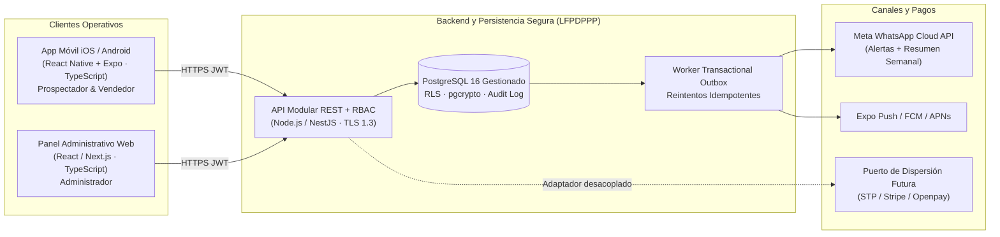

# App IngresoCerteza — Arquitectura de Referencia y Prototipo Funcional

[](https://github.com/Julsanchezc/ingreso-certeza-poc/actions/workflows/ci.yml)

Prototipo de ingeniería y validación de reglas de negocio para **App IngresoCerteza**: plataforma móvil multiplataforma (iOS y Android) con panel administrativo web orientada a gestionar redes de prospectadores de seguros, venta cruzada multi-ramo, liquidación auditable de comisiones y notificaciones automáticas por **Meta WhatsApp Cloud API** y **Push (FCM/APNs)**.

Autor: **Julián Sánchez** ([github.com/Julsanchezc](https://github.com/Julsanchezc) · `julsanchezc@unal.edu.co`).

---

## Qué resuelve este repositorio

Los sistemas genéricos de CRM fallan en corretaje de seguros por tres motivos concretos: pierden el vínculo con el referidor inicial cuando un agente coloca una segunda póliza al mismo cliente, permiten descartar prospectos sin justificación auditable y calculan comisiones sobre promesas en lugar de pólizas efectivamente pagadas. Este repositorio implementa y verifica las invariantes exactas solicitadas en el RFP antes de escalar las vistas móviles y administrativas:

1. **Expediente único y Venta Cruzada (Multi-negocio)**: Un prospecto ingresado por *Seguro de Auto* conserva de forma inmutable su `originalReferrerId`; cuando el vendedor agrega *Gastos Médicos Mayores* o *PPR* sobre el mismo expediente, ambas comisiones se acreditan al prospectador original con la tasa propia de cada ramo.
2. **Máquina determinista de 7 etapas comerciales**: Bloquea el paso a *En Proceso de Cotización* sin monto estimado de prima, habilita *Comisión Lista para Cobro* únicamente en la etapa 6 (*Póliza Emitida y Pagada*) y exige motivo documentado al marcar *Descartado / No Concretado*, registrando bitácora inmutable de auditoría.
3. **Motor multi-nivel de comisiones y catálogo extensible**: Resuelve porcentajes específicos por par `(prospectador, ramo)` con respaldo automático en el porcentaje base del producto y soporte para alta dinámica de nuevos ramos.
4. **Integración con Meta WhatsApp Cloud API y Resumen Semanal**: Normaliza teléfonos al estándar internacional E.164 (`+52` México / `+57` Colombia) y construye los payloads oficiales de plantillas tanto para alertas inmediatas de avance como para el corte semanal (comisiones confirmadas, comisiones en cotización y referidos pendientes).
5. **Simulador unificado de los 3 perfiles (Móvil + Web Admin)**: Interfaz interactiva sin dependencias pesadas que permite operar en vivo la vista móvil del **Prospectador**, la vista móvil del **Vendedor** y el dashboard analítico del **Administrador** (embudo, desglose de estancamiento, desempeño por ramo, ranking y exportación CSV/impresión PDF).

---

## Arquitectura Objetivo de Producción



Para revisar el detalle de restricciones relacionales, seguridad bajo la **LFPDPPP** y secuencia del patrón *Transactional Outbox*, consulta [docs/ARCHITECTURE.md](./docs/ARCHITECTURE.md).

---

## Ejecución Rápida (30 segundos)

El núcleo de dominio utiliza módulos ES estándar y el ejecutor nativo de pruebas de Node.js ($\ge 20$), sin requerir claves externas ni instalaciones pesadas para su inspección técnica.

```bash
# 1. Ejecutar la suite completa de pruebas unitarias y casos de borde
npm test

# 2. Levantar el simulador interactivo (App Prospectador + App Vendedor + Panel Web Admin)
npm run demo
```

Abre `http://127.0.0.1:4173/web-demo/index.html` en el navegador para interactuar con los tres roles en tiempo real.

---

## Estructura del Proyecto

| Ruta | Responsabilidad |
| :--- | :--- |
| `db/schema.sql` | Esquema DDL PostgreSQL 16 con RBAC, Row-Level Security, `pgcrypto` (LFPDPPP), triggers de inmutabilidad y cola `notification_outbox`. |
| `db/seed_demo.sql` | Conjunto de datos semilla con los 7 ramos iniciales, reglas personalizadas y expedientes multi-ramo. |
| `src/domain/constants.mjs` | Catálogo extensible de los 7 ramos de seguro, las 7 etapas del ciclo comercial y estados de liquidación. |
| `src/domain/commissionEngine.mjs` | Resolución jerárquica de porcentajes por prospectador/ramo y cálculo exacto de comisiones proyectadas vs. pagables. |
| `src/domain/stageMachine.mjs` | Autómata de estados, candados de validación, venta cruzada con atribución inmutable y bitácora auditable. |
| `src/domain/whatsappNotifier.mjs` | Normalizador telefónico E.164 y constructor de payloads para Meta WhatsApp Cloud API + Push + Resumen Semanal. |
| `src/domain/kpiAnalytics.mjs` | Cálculo de fuerza activa, tasas de conversión, desglose de estancamiento, rendimiento por ramo y ranking de referidores. |
| `web-demo/` | Simulador visual interactivo conectado en vivo al motor de dominio para validar flujos de Prospectador, Vendedor y Administrador. |
| `tests/domain.test.mjs` | Pruebas automatizadas (`node:test`) de reglas comerciales, permisos RBAC y restricciones de borde. |
| `docs/ARCHITECTURE.md` | Decisiones de arquitectura (ADR), modelo entidad-relación y lineamientos de seguridad LFPDPPP. |
