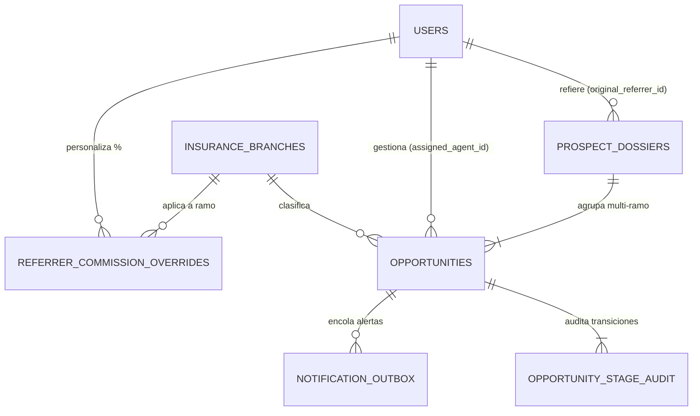
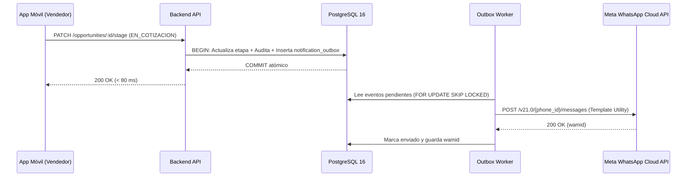

# Decisiones de Arquitectura (ADR) — App IngresoCerteza PoC

Este documento registra los criterios de ingeniería detrás del modelo de datos, el motor de dominio y el esquema de integración para **App IngresoCerteza**.

---

## 1. Expediente Único con Atribución Inmutable en Venta Cruzada

En corretaje de seguros, el conflicto comercial más frecuente entre referidores y agentes surge cuando un prospecto ingresa por una póliza inicial (por ejemplo, *Seguro de Auto*) y semanas después el vendedor coloca un segundo producto de mayor prima (*Gastos Médicos Mayores* o *PPR*). Si cada producto se registra como un prospecto suelto, la trazabilidad hacia el prospectador original se rompe.

Separamos la identidad en dos niveles relacionales:

- **`prospect_dossiers`**: Almacena los datos de contacto validados del cliente y fija `original_referrer_id` en el momento del alta. Ni el vendedor ni procesos posteriores de venta cruzada pueden reescribir ese vínculo.
- **`opportunities`**: Representa cada negocio individual por ramo dentro del expediente. Al añadir una oportunidad cruzada, el motor hereda el `original_referrer_id` del expediente padre y resuelve el porcentaje correspondiente al nuevo ramo.

---

## 2. Máquina Determinista de 7 Etapas y Liquidación de Comisiones

El proceso comercial opera como un autómata finito con candados explícitos tanto en la capa de dominio (`src/domain/stageMachine.mjs`) como en restricciones `CHECK` de PostgreSQL (`db/schema.sql`):

| Etapa | Código Interno | Estatus de Comisión | Regla de Integridad Exigida |
| :--- | :--- | :--- | :--- |
| 1 | `NUEVO` | `PENDIENTE` | Alta inicial con al menos un ramo activo y teléfono E.164 válido. |
| 2 | `PRIMER_CONTACTO` | `PENDIENTE` | Registro de llamada efectuada por el vendedor asignado. |
| 3 | `CITA_AGENDADA` | `PENDIENTE` | Confirmación de encuentro comercial con el prospecto. |
| 4 | `EN_COTIZACION` | `EN_PROCESO` | Obliga `estimated_premium > 0`; proyecta comisión estimada en tiempo real. |
| 5 | `SOLICITUD_LLENADA` | `EN_PROCESO` | Mantiene proyección activa mientras la aseguradora suscribe el riesgo. |
| 6 | `POLIZA_PAGADA` | `LISTA_PARA_COBRO` | Única etapa que libera pago al referidor sobre prima cobrada (`final_premium > 0`). |
| 7 | `DESCARTADO` | `CANCELADA` | Bloquea el cierre si no existe `rejection_reason` documentado ($\ge 5$ caracteres). |

Cada cambio inserta un registro en `opportunity_stage_audit` protegido contra `UPDATE` y `DELETE`. Ningún cambio de etapa carece de autor, marca temporal y estado previo.

---

## 3. Patrón Transactional Outbox hacia Meta WhatsApp Cloud API

Invocar directamente una API HTTP externa (Meta Graph API o FCM) dentro de la misma transacción en que el vendedor avanza una etapa introduce dos fallos clásicos: latencia en la app móvil si Meta tarda en responder, o pérdida silenciosa de la alerta si la red cae tras guardar en PostgreSQL.

Conectarse directo a **Meta WhatsApp Cloud API** mediante plantillas de categoría *Utility* elimina el sobrecargo por mensaje de proveedores intermediarios (como Twilio), mantiene predecible la factura mensual del despacho y conserva acuses de entrega (`sent`, `delivered`, `read`) por webhook.

---

## 4. Controles de Seguridad y Privacidad (LFPDPPP)

Dado que el sistema trata datos personales y patrimoniales de asegurados en jurisdicción mexicana (**Ley Federal de Protección de Datos Personales en Posesión de los Particulares**):

1. **Consentimiento trazable**: Registro obligatorio de fecha y versión del aviso de privacidad aceptado al dar de alta el expediente.
2. **Protección en tránsito y reposo**: Transporte exclusivo sobre HTTPS/TLS 1.3; cifrado de disco AES-256 en la instancia administrada de PostgreSQL y soporte `pgcrypto` para columnas sensibles, conservando hashes deterministas con sal para detección de duplicados sin exponer texto plano en índices secundarios.
3. **Aislamiento por Rol (RBAC + RLS)**:
   - `PROSPECTADOR`: Lectura estricta de sus propios expedientes y proyecciones de comisión; cero visibilidad sobre carteras ajenas.
   - `VENDEDOR`: Lectura y transición operativa únicamente sobre oportunidades asignadas, más apertura de ventas cruzadas en esos expedientes.
   - `ADMIN`: Gobierno global de usuarios, reglas de comisión por prospectador/ramo, catálogo de productos y exportación ejecutiva.
